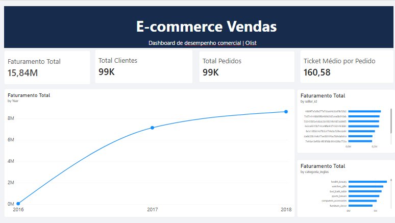

# E-commerce Data Warehouse

Projeto de Engenharia de Dados desenvolvido para praticar a construção de um pipeline ETL, modelagem dimensional e análise de dados de vendas utilizando Python, PostgreSQL, SQL e Power BI.

## Objetivo

Construir um pipeline de dados que extraia informações de um conjunto de dados de e-commerce, realize transformações e carregue os dados em um Data Warehouse para análise de indicadores comerciais.

## Tecnologias utilizadas

- **Python:** extração, transformação e carregamento dos dados.
- **Pandas:** manipulação e limpeza dos dados.
- **PostgreSQL:** armazenamento dos dados e implementação do Data Warehouse.
- **SQL:** consultas analíticas e modelagem dimensional.
- **Pytest:** testes automatizados.
- **Power BI:** criação do dashboard interativo.
- **Git e GitHub:** versionamento do projeto.

## Arquitetura do projeto

```text
Arquivos CSV
    ↓
Extração com Python
    ↓
Transformação e validação dos dados
    ↓
Banco de dados PostgreSQL
    ↓
Camada Staging
    ↓
Data Warehouse
    ↓
Consultas analíticas SQL
    ↓
Dashboard Power BI
```

## Modelagem dimensional

O Data Warehouse utiliza um modelo dimensional em estrela, composto por uma tabela fato e dimensões.

### Tabela fato

- `fato_vendas`: armazena os itens dos pedidos, incluindo preço, frete e valor total do item.

**Granularidade:** cada registro representa um item de um pedido.

### Tabelas dimensão

- `dim_cliente`: informações dos clientes e localização.
- `dim_produto`: informações dos produtos e categorias.
- `dim_vendedor`: informações dos vendedores e localização.
- `dim_tempo`: atributos de data, mês, trimestre e ano.

## Principais análises

O projeto utiliza consultas SQL e um dashboard no Power BI para analisar:

- Faturamento total e valor do frete.
- Quantidade de pedidos e clientes.
- Ticket médio por pedido.
- Evolução mensal do faturamento.
- Faturamento por categoria de produto.
- Desempenho dos vendedores.
- Indicadores comerciais com filtros por período, estado e categoria.

## Testes e qualidade dos dados

Foram implementados testes automatizados com Pytest e verificações de qualidade dos dados, incluindo:

- Validação dos dados extraídos e transformados.
- Identificação de itens de pedidos duplicados.
- Verificação de valores nulos e medidas negativas.
- Conferência do cálculo do valor total dos itens.
- Verificação da integridade referencial entre a tabela fato e as dimensões.

## Como executar o projeto

### 1. Clone o repositório

```bash
git clone URL_DO_SEU_REPOSITORIO
cd e-commerce-datawarehouse
```

### 2. Crie e ative o ambiente virtual

No Windows, utilizando PowerShell:

```powershell
python -m venv .venv
.\.venv\Scripts\Activate.ps1
```

### 3. Instale as dependências

```powershell
pip install -r requirements.txt
```

### 4. Configure as variáveis de ambiente

Crie um arquivo `.env` a partir do `.env.example` e configure as credenciais do PostgreSQL, o nome do banco de dados e a porta utilizada.

**Não compartilhe suas senhas nem envie o arquivo `.env` para o GitHub.**

### 5. Prepare os dados

Disponibilize os arquivos CSV esperados pelo projeto no diretório `data/raw/`.

### 6. Execute o pipeline

```powershell
python -m src.main
```

### 7. Execute os testes automatizados

```powershell
python -m pytest tests/ -v
```

## Dashboard

O dashboard foi desenvolvido no Power BI para apresentar os principais indicadores comerciais, a evolução do faturamento e o desempenho de categorias e vendedores.



## Aprendizados

Este projeto permitiu praticar conceitos de Engenharia de Dados, incluindo:

- Desenvolvimento de pipelines ETL com Python.
- Manipulação de dados com Pandas.
- Integração entre Python e PostgreSQL.
- Modelagem dimensional e construção de um Data Warehouse.
- Escrita de consultas SQL analíticas.
- Testes automatizados e validação da qualidade dos dados.
- Visualização de indicadores com Power BI.

## Próximas melhorias

- Automatizar a execução periódica do pipeline.
- Implementar monitoramento e logs mais detalhados.
- Explorar a orquestração de pipelines.
- Avaliar a utilização de serviços de nuvem para armazenamento e processamento de dados.

---

**Projeto desenvolvido para fins de aprendizado e portfólio em Engenharia de Dados.**